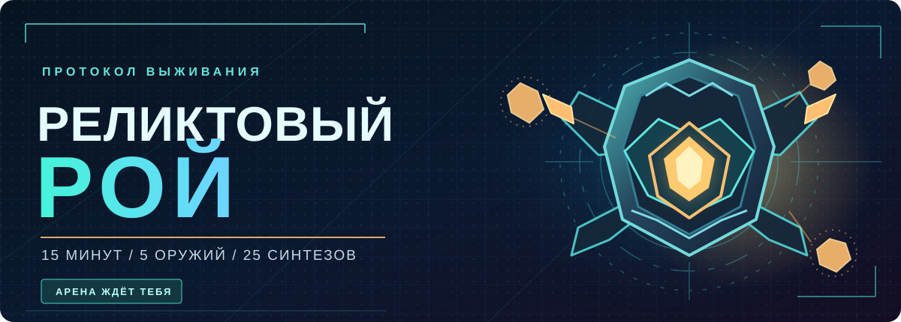

  

  <h3>Выживи. Усиль оружие. Создай невозможную комбинацию.</h3>

  
Динамичный браузерный roguelite про боевого робота, бесконечную прокачку и битвы с боссами.

  

    
    
    
  

  
<b>Без установки · Без регистрации · Бесплатно</b>

---

## ⚡ Пятнадцать минут до Омеги

Ты управляешь боевым роботом внутри арены, которую постепенно заполняет враждебный рой. Оружие атакует само, но оставаться на месте нельзя: двигайся, уходи от опасностей, выбирай улучшения и собирай свой безумный билд.

Чем дольше длится забег, тем сильнее сопротивление. Финальная цель — пережить натиск и победить Омегу.

| **11 видов оружия** | **25 рецептов синтеза** | **5 слотов за забег** |
| :---: | :---: | :---: |
| От лазеров до гравитационных аномалий | Соединяй два вида оружия и открывай новые механики | Каждое решение меняет твою сборку |

## ◈ Собери оружие, которое не остановить

| | |
| :--- | :--- |
| ⚔️ **Разные боевые стили** | Лазерные дуги, ракеты, огонь, крио, пилы, плазма и другое оружие с собственным поведением. |
| 🔧 **Прокачка без искусственного потолка** | Усиливай урон, скорость атак, радиус, количество снарядов и другие характеристики. |
| ✨ **Синтез вооружения** | Побеждай особых боссов, добывай ядра и превращай два оружия в одно новое. |
| 👾 **Рой становится опаснее** | Волны врагов, элитные противники, боссы и специальные события меняют темп боя. |
| 💎 **Прогресс между забегами** | Собирай кристаллы, покупай постоянные улучшения и открывай новые облики робота. |

## 🎮 Играй так, как удобно

| **На компьютере** | **На телефоне** |
| :--- | :--- |
| **WASD** / стрелки — движение | Плавающий джойстик — движение |
| **Пробел** — рывок | Кнопка «Рывок» |
| **Esc** — пауза | Кнопка паузы на экране |

Стрельба автоматическая. Твоя задача — выживать и собирать правильные комбинации.

Игра запускается прямо в современном браузере на ПК, Android и iPhone. Производительность на разных устройствах может отличаться.

## 🚀 Готов вступить в бой?

### [▶ НАЧАТЬ ЗАБЕГ](https://barvolar.github.io/RelictSwarm/)

**15 минут. Один робот. Целый рой.**

---

<b>🛠️ Открытое тестирование и обратная связь</b>

«Реликтовый рой» активно развивается: баланс, интерфейс и производительность могут меняться. Нашёл ошибку, заметил просадку или придумал интересное сочетание оружия? Поделись в разделе [**Issues**](https://github.com/barvolar/RelictSwarm/issues).

<b>🔒 Конфиденциальность</b>

Игра сохраняет прогресс в браузере. Дополнительная отправка анонимной игровой статистики возможна только с согласия игрока и при наличии подключённого сервера аналитики. Выбор можно изменить в настройках.

  © 2026 · Реликтовый рой · Независимый HTML5-проект

